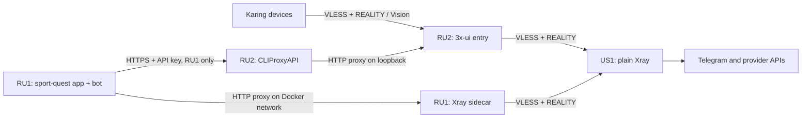

# Infrastructure

Deployment status: 2026-10-29. RU1 has a clean installation populated from a fresh production snapshot. Its app, database, disabled bot and sidecar are healthy. The app is private on `127.0.0.1:13000`; public cutover is pending approval. The old instance at `82.146.60.122` is still running. The user explicitly reauthorized read-only inspection and migration preparation; do not stop or alter the old instance before cutover approval. DNS for `tl-sport.ru` already points to RU1, but public web ports have not been activated. Do not push this branch to `main` until the final snapshot and CI destination are ready.

## Topology

US1 is `89.125.43.209`, RU1 is `178.236.242.177`, and RU2 is `178.236.242.184`. Management panels exist only on RU2. The default VPN policy sends all destinations through US1. CLIProxyAPI and the Telegram sidecar have no direct fallback.

The RU2 entry runs a compatibility build from official Xray **26.7.28** source, compiled with **Go 1.26.10** and dependency security fixes. The source commit, dependency pins and executable SHA256 are recorded in the private Network folder's `entry-core.json`. Its REALITY target/SNI is `www.cloudflare.com`, with explicit `minClientVer=1.0.0`. Xray 26.10.21 remains on US1 and in the RU1 sidecar; those two server-to-server connections use `www.microsoft.com`.

This entry pin is intentional: the tested sing-box 1.12.22 client fails REALITY authentication with Xray 26.9.8+, including 26.10.21. An isolated and then live sing-box test with the compatibility build exited through US1. A contemporary Xray client also passed. The user requested returning to REALITY after a TLS trial; the active subscription contains REALITY. On 2026-10-29, the user confirmed Karing works with the fresh native VLESS subscription and reports exit IP `89.125.43.209`.

The compatibility binary's Go vulnerability scan reported no findings for linked packages. The remaining module-level OpenPGP notice concerns an unlinked package. This is a maintained local build, not an upstream security-support promise; recheck advisories and client compatibility before upgrading it.

## Ports

| Host | TCP port | Allowed callers / purpose |
| --- | --- | --- |
| All | 22 | SSH keys only |
| US1 | 443 | RU1/RU2 source IPs only; VLESS/REALITY exit |
| RU1 | 80, 443 | Public application HTTP/HTTPS, once restored |
| RU2 | 443 | Public VLESS/REALITY device entry |
| RU2 | 80 | ACME HTTP-01 |
| RU2 | 8443 | HTTPS subscription paths only |
| RU2 | 9443 | RU1 source IP only; `/v1/models` and `/v1/chat/completions`, with API key |
| RU2 loopback | 58428 | Private 3x-ui panel, random path and credentials |
| RU2 loopback | 2096 | Subscription backend; validated Host header |
| RU2 loopback | 18080 | HTTP proxy used by CLIProxyAPI |
| RU2 loopback | 8317 | CLIProxyAPI API and management |
| RU2 loopback | 62789, 11111 | Xray control API and metrics |
| RU1 Docker network | 18080 | Sidecar HTTP proxy; no host port mapping |

RU1 also permits UDP 443 for Caddy HTTP/3. The nftables table `inet network_guard` defaults to denying inbound traffic. Its Docker forwarding rules prevent unintended published ports from bypassing the RU1 policy. CLIProxyAPI runs as UID 10001; new outbound connections for that UID are limited to its own localhost API and the localhost proxy. Existing replies are allowed. SSH root login requires a key; password and keyboard-interactive authentication are disabled. Automatic OS security updates are enabled.

## Configuration and access

| Location | Contents |
| --- | --- |
| Local `/Users/roman.kutimskii/Documents/ChatGPT/Network` | Private infrastructure source, version pins and setup scripts |
| Local `.env` | Literal provider bootstrap credentials, mode 0600; never source it |
| Local `.secrets/access.txt` | Panel links, credentials, subscription, API keys |
| Local `.secrets/state.json` | Stable UUIDs, REALITY keys, generated secrets |
| Local `.state/known_hosts` | Pinned SSH host keys |
| US1 `/etc/xray/config.json` | Exit config; `/usr/local/bin/xray` points to the versioned binary |
| RU2 `/etc/x-ui/x-ui.db` | Panel database, clients and core settings |
| RU2 `/usr/local/x-ui/bin/config.json` | Generated runtime config; edit through the panel/API instead |
| RU2 `/opt/network/entry-core.json` | Compatibility build pin |
| RU2 `/opt/cliproxyapi/compose.yml` | Provider service deployment |
| RU2 `/opt/cliproxyapi/config/config.yaml` | Mutable CLIProxyAPI v8 configuration |
| RU2 `/opt/cliproxyapi/state` | Provider authentication and management UI state |
| RU2 `/etc/caddy/Caddyfile` | Subscription/API HTTPS endpoints |
| All `/etc/network-firewall.nft` | Persistent rules applied by `network-guard.service` |
| RU1 `/opt/sport-quest/.env.prod` | Fresh database/session secrets, preserved Telegram app settings, new proxy/API routes; bot off pending cutover |
| RU1 `/opt/sport-quest/compose.prepare.yml` | Private preparation overlay; app bound only to loopback, public proxy and worker selected explicitly |

From the Network folder, run `python3 scripts/tunnel.py start`. The panel uses local port 25843 and its private path; CLIProxyAPI management is at `http://127.0.0.1:8317/management.html`. The helper also forwards provider OAuth callback ports 1455, 51121, 54545 and 8085. Stop it with `python3 scripts/tunnel.py stop`. Never expose these management ports publicly.

The HTTPS subscription format is `https://sub.roman-kutimskii.ru:8443/sub/<private-id>`. Use the actual URL in `.secrets/access.txt`; it is a credential. Replace the earlier Mihomo import with a fresh native VLESS profile using `.secrets/karing-setup.txt`, then reconnect **RU → US**. This format, Cloudflare SNI and minClientVer 1.0.0 match the user’s working reference server at 78.24.217.100. The native subscription passed TCP egress and UDP DNS tests from the Mac, and the user separately confirmed successful access from Karing. The expected exit IP is `89.125.43.209`. Karing should show REALITY, Vision, fingerprint `chrome`, and SNI `www.cloudflare.com`.

To add a VPN client, open the private 3x-ui panel, edit the existing `vpn-entry` inbound, and add a distinct UUID/email/subscription ID with Vision enabled. Keep the outbound routing and transport settings. Use that client's HTTPS subscription URL. Separate subscription IDs make revocation independent. Two-factor authentication was deferred by the user and remains an outstanding action.

## Application configuration

Set `TELEGRAM_PROXY_URL=http://xray:18080`. The sidecar reads `XRAY_US_ADDRESS`, `XRAY_US_PORT`, `XRAY_CLIENT_UUID`, `XRAY_REALITY_PUBLIC_KEY`, `XRAY_REALITY_SHORT_ID` and `XRAY_REALITY_SERVER_NAME` from the environment. It generates its config in a tmpfs and runs without root privileges or host-published ports.

Use `LLM_BASE_URL=https://llm.roman-kutimskii.ru:9443` (without `/v1`), the private API key, and `LLM_MODEL=gemini-3.8-flash-high`. The application appends the API path. A completion with that model succeeded from RU1 through CLIProxyAPI; the provider may return a normalized model name.

The code uses an HTTP proxy dispatcher. Bot API calls and Telegram file downloads need `api.telegram.org`; OIDC token/JWKS requests need `oauth.telegram.org`. Direct requests to these endpoints timed out from both RU hosts during inspection, while US egress worked. These are measurements from these VMs, not a claim about every Russian provider. Browser-side Telegram authentication still happens on the user's device.

The sidecar healthcheck requests Telegram JWKS through the proxy. The bot waits for sidecar health and reports polling freshness. `/api/health` checks the application database and returns only a status, not configuration. Network errors omit tokens, proxy passwords and upstream response bodies. The app can stay up during a transient Telegram outage; bot requests retry through the proxy.

## Deployment and restoration

A push to `main` runs production deployment. Keep the work on `codex/chained-vpn-infra` until cutover approval. GitHub deploy secrets are scoped to the **production environment**, not repository-level secrets; their target has not yet been changed.

Preparation created a fresh database and session secret, applied every Prisma migration, and seeded only the quest without sample participants. A fresh read-only production snapshot was then restored into a separate database and validated. The clean database was preserved as `sportquest_clean_<snapshot timestamp>` before swapping the restored database into the private installation. Upload archives are validated for safe paths and every restored file is checked against the current source SHA-256 manifest. The existing upload archive was reused only after all of its files matched the live source byte-for-byte.

The restored site's homepage and database health endpoint return 200. Every local proof reference resolves to a restored file, and anonymous proof requests correctly return 401. Telegram login initiation redirects to Telegram with the correct callback, PKCE and secure HTTP-only cookies. Inside the new bot container, `getMe`, Telegram OIDC JWKS and the US exit check pass; a synthetic activity message is correctly classified through CLIProxyAPI without writing a report or sending a message. Actual human login remains a post-cutover check. Local lint and all 155 tests pass; app/tools/sidecar Docker builds passed on RU1.

For final cutover, obtain approval to pause old app/bot writers, take a final consistent snapshot and refresh RU1. Preserve the prior database/uploads for rollback. Install the dedicated RU1 CI key, update `DEPLOY_HOST`, `DEPLOY_SSH_KEY` and `DEPLOY_KNOWN_HOSTS` in GitHub's `production` environment, then release through the normal `main` flow. Publish Caddy on RU1 and activate only the new bot. The A record is already RU1 (`178.236.242.177`), so no further DNS change is required. Keep the old server intact until acceptance.

The private Network workspace contains `clean-app.py`, `snapshot-current-production.py`, `restore-app.py` and `verify-restored-app.py`, plus the restore evidence and rollback configuration. These preparation scripts do not perform public cutover. One-off Compose commands disable stdin so they cannot consume the rest of an SSH-fed shell script.

Known performance issue: bulk HTTPS downloads through the RU–US tunnels were slow and timed out in bounded tests, while direct VM transfers were fast. Small Telegram requests and the application's synthetic LLM classification pass, but media-download performance still needs investigation.

## Maintenance, rotation and backups

Use the Network folder's checksum-verified setup scripts. Preserve `.secrets/`, the known-host file, panel database and provider state when rerunning them. The RU2 installer reapplies the exact entry-core pin, so upgrading 3x-ui cannot silently replace it with an incompatible bundled core. Before upgrades, read release notes, back up mutable state, validate configs, and run both modern-Xray and sing-box connection checks. Avoid 3x-ui's direct core-update button until the intended version passes those checks.

For an entry UUID rotation, add and test a replacement client before removing the old one. Revoke its subscription ID as well if that URL was exposed. For RU1/RU2 exit credentials, add the new UUID on US1 first, update one caller, test it, then remove the old UUID. REALITY key rotation requires coordinated server/client public-key and short-ID updates; stage an additional inbound/client path rather than overwriting the only working path. Keep SSH/firewall changes behind the documented explicit approval and timed rollback process.

Before changes, make a consistent SQLite backup of `/etc/x-ui/x-ui.db` using SQLite's backup API. Preserve CLIProxyAPI config and authentication state, Caddy state under `/var/lib/caddy/.local/share/caddy`, US1 Xray config, firewall files, systemd units and version/build manifests. These contain secrets and need owner-only access and encrypted off-host storage. The entry changes created local-to-RU2 rollback backups under `/opt/network/backups`; scheduled off-host backups are not configured yet.

After the app is restored, back up Postgres with `pg_dump -Fc`, plus the uploads volume and `.env.prod`. A consistent migration snapshot requires quiescing writers or coordinating database/uploads timestamps. Validate backups by restoring into a separate database/volume; never restore directly over production as a test. Retain both the initial and fresh migration snapshots. A staging snapshot taken while the old bot is running is not a final cutover snapshot; freeze old writers before the final refresh.

## Sources

- [Karing REALITY compatibility issue](https://github.com/KaringX/karing/issues/1952)
- [sing-box handshake investigation](https://github.com/SagerNet/sing-box/issues/4520)
- [Xray 26.7.28 source](https://github.com/XTLS/Xray-core/tree/5ca6f4b7d4dc20a881d4330e498892697627ec0c)
- [Go 1.26.10 security release](https://groups.google.com/g/golang-announce/c/66pojueaQek)
- [3x-ui 3.11.0](https://github.com/MHSanaei/3x-ui/releases/tag/v3.11.0)
- [CLIProxyAPI](https://github.com/router-for-me/CLIProxyAPI)
