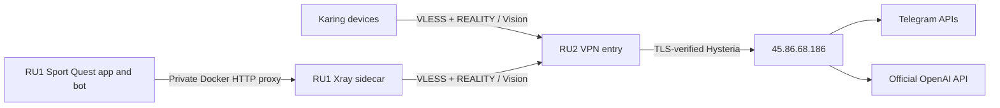

# Infrastructure

Migration release: 2026-10-29. RU1 is the production target for the app, database, bot, Caddy and Telegram sidecar. Preparation used a clean installation, a fresh production snapshot and private validation on `127.0.0.1:13000`. The user approved final cutover: freeze the old app/bot, refresh the data, install the dedicated CI key, update GitHub's production environment and release through `main`. The old host `82.146.60.122` is retained for rollback. Do not restart its bot while the RU1 bot is live. DNS for `tl-sport.ru` already points to RU1. Runtime completion and verification are recorded at `/opt/network/app-cutover-complete` and in the private Network workspace; the preparation snapshot alone is not proof of a completed cutover.

## Topology

RU1 is `178.236.242.177`, and RU2 is `178.236.242.184`. RU2 runs Xray **26.7.28** with pinned Go and dependency updates for sing-box compatibility. The Network workspace's `entry-core.json` records the source, toolchain, and SHA-256. The REALITY target is `www.cloudflare.com:443`, the advertised SNI is `cloudflare.com`, and the client minimum is `1.0.0`. The RU1 sidecar runs Xray 26.10.21 and uses the same RU2 entry as the device profile.

## Ports

| Host | Port | Access |
| --- | --- | --- |
| RU1 | TCP 80 and 443, UDP 443 | Public application HTTP, HTTPS and HTTP/3 |
| RU2 | TCP 2053 | Public VLESS/REALITY entry |
| RU2 | TCP 80 and 8443 | ACME HTTP-01 and HTTPS subscriptions |
| RU2 loopback | TCP 2096 | Subscription backend |
| RU2 loopback | TCP 18080 and 18082 | Diagnostic HTTP proxy and Hysteria SOCKS listener |
| Exit | UDP 24443 | Hysteria from RU2 only |
| RU1 Docker network | TCP 18080 | Private Xray HTTP proxy |

The RU1 and RU2 nftables policies deny inbound traffic by default. RU1 allows Docker forwarding for the Caddy ports. The exit limits Hysteria to RU2's source address and blocks private destination ranges. RU1 and RU2 use key-only SSH.

## Configuration and access

| Location | Contents |
| --- | --- |
| Local `/Users/roman.kutimskii/Documents/ChatGPT/Network` | Private infrastructure scripts and version pins |
| Local `.env` | Provider bootstrap credentials with mode 0600 |
| Local `.secrets/access.txt` | Panel credentials and private subscription URL |
| Local `.secrets/state.json` | Stable VPN and panel credentials |
| Local `.state/known_hosts` and `.state/new-exit-known_hosts` | Pinned SSH host keys |
| RU2 `/etc/x-ui/x-ui.db` | Panel database, clients and core settings |
| RU2 `/usr/local/x-ui/bin/config.json` | Runtime configuration generated from the panel |
| RU2 `/etc/caddy/Caddyfile` | HTTPS subscription frontend |
| RU2 and exit `/etc/network-hysteria-extra/` | TLS-verified transport configuration |
| RU1 `/opt/sport-quest/.env.prod` | Production application, proxy and volume settings |

Run `python3 scripts/tunnel.py start` from the Network folder for the local 3x-ui forward on port 25843. Use the panel path from the private access file, then close the forward with `python3 scripts/tunnel.py stop`.

The native VLESS subscription uses `https://sub.roman-kutimskii.ru:8443/sub/<private-id>`. It publishes **🇷🇺 RU → 🇺🇸 US** with exit IP `45.86.68.186`. The Karing profile uses REALITY, Vision, fingerprint `chrome`, and SNI `cloudflare.com`. To add a client, use the managed port-2053 inbound and assign a distinct client UUID, email, and subscription ID with Vision enabled.

## Application configuration

Set `TELEGRAM_PROXY_URL=http://xray:18080`. The sidecar reads `XRAY_US_ADDRESS`, `XRAY_US_PORT`, `XRAY_CLIENT_UUID`, `XRAY_REALITY_PUBLIC_KEY`, `XRAY_REALITY_SHORT_ID` and `XRAY_REALITY_SERVER_NAME` from the environment. It generates its config in a tmpfs and runs without root privileges or host-published ports.

The repository now defaults to the official OpenAI API: `LLM_BASE_URL=https://api.openai.com` (without `/v1`), `OPENAI_API_KEY` from OpenAI API Platform, and `LLM_MODEL=gpt-6.1-terra`. The application appends `/v1/chat/completions`, sends image data URIs and JSON mode, and uses medium reasoning without temperature. The old `LLM_API_KEY` is deliberately not reused. Set `LLM_PROXY_URL=http://xray:18080` on RU1: the HTTP proxy establishes a CONNECT tunnel through RU2 and the Hysteria exit, while TLS and API authentication terminate at OpenAI. A failed proxy request is retried through the same route; there is no direct fallback.

For rollout, replace the old `LLM_BASE_URL` and `LLM_MODEL` overrides in `/opt/sport-quest/.env.prod`, supply `OPENAI_API_KEY`, and set `LLM_PROXY_URL`. Both the bot and one-off tools receive these settings. Back up `.env.prod` and `compose.prod.yml` before changing them; keep the backup with the previous image tag for rollback. The old CLIProxyAPI service on RU2 is not used by the bot after this change.

The November 9 verification returned HTTP 200 for the authenticated OpenAI model lookup from the running bot through the production proxy.

The final local Terra eval passed all 66/66 cases, including every image fixture, date, step count and bingo field (report precision and recall 100% on this set). The prompt clarifies existing rules for completed construction work and food-only captions after a workout. Scoring thresholds are unchanged. Local lint and all 164 unit tests pass; source type checking passes when excluding stale `.next/dev/types` references to removed gallery/vote pages.

The pre-release configuration backup is `/opt/sport-quest/backups/openai-terra-20261102T115716Z/` on RU1. It contains the old `.env.prod` and `compose.prod.yml`, including image tag `d7cf1ca620e66f74e75b68d19e59282b2f136326`. A provider rollback must restore both configuration files before recreating the bot; changing only `IMAGE_TAG` would retain incompatible OpenAI environment settings.

The code uses an HTTP proxy dispatcher. Bot API calls and Telegram file downloads need `api.telegram.org`; OIDC token/JWKS requests need `oauth.telegram.org`. Direct requests to these endpoints timed out from both RU hosts during inspection, while US egress worked. These are measurements from these VMs, not a claim about every Russian provider. Browser-side Telegram authentication still happens on the user's device.

The sidecar healthcheck requests Telegram JWKS through the proxy. The bot waits for sidecar health and reports polling freshness. `/api/health` checks the application database and returns only a status, not configuration. Network errors omit tokens, proxy passwords and upstream response bodies. The app can stay up during a transient Telegram outage; bot requests retry through the proxy.

## Deployment and restoration

A push to `main` runs production deployment. GitHub deploy secrets are scoped to the **production environment**, not repository-level secrets. The approved migration installs a dedicated RU1-only deploy key and updates the target before pushing the release.

Preparation created a fresh database and session secret, applied every Prisma migration, and seeded only the quest without sample participants. A fresh read-only production snapshot was then restored into a separate database and validated. The clean database was preserved as `sportquest_clean_<snapshot timestamp>` before swapping the restored database into the private installation. Upload archives are validated for safe paths and every restored file is checked against the current source SHA-256 manifest. The existing upload archive was reused only after all of its files matched the live source byte-for-byte.

The restored site's homepage and database health endpoint return 200. Every local proof reference resolves to a restored file, and anonymous proof requests correctly return 401. Telegram login initiation redirects to Telegram with the correct callback, PKCE and secure HTTP-only cookies. Inside the new bot container, `getMe`, Telegram OIDC JWKS and the US exit check pass; a synthetic activity message is correctly classified through CLIProxyAPI without writing a report or sending a message. Actual human login remains a post-cutover check. Local lint and all 155 tests pass; app/tools/sidecar Docker builds passed on RU1.

The approved final cutover pauses old app/bot writers to take a final consistent snapshot and refresh RU1. Preserve the prior database/uploads for rollback. Install the dedicated RU1 CI key, update `DEPLOY_HOST`, `DEPLOY_SSH_KEY` and `DEPLOY_KNOWN_HOSTS` in GitHub's `production` environment, then release through the normal `main` flow. Publish Caddy on RU1 and activate only the new bot. The A record is already RU1 (`178.236.242.177`), so no further DNS change is required. Keep the old server intact until acceptance.

`UPLOADS_VOLUME` selects the restored uploads volume (default `sport-quest_uploads`). A final refresh restores into a new named volume and a new database; the previous database and volume remain available for rollback. Back up the volume selected by the deployed Compose configuration, rather than assuming the default name.

The private Network workspace contains `clean-app.py`, `snapshot-current-production.py`, `restore-app.py` and `verify-restored-app.py`, plus the restore evidence and rollback configuration. These preparation scripts do not perform public cutover. One-off Compose commands disable stdin so they cannot consume the rest of an SSH-fed shell script.

Known performance issue: bulk HTTPS downloads through the RU–US tunnels were slow and timed out in bounded tests, while direct VM transfers were fast. Small Telegram requests and the application's synthetic LLM classification pass, but media-download performance still needs investigation.

## Maintenance, rotation and backups

Use the Network folder's checksum-verified setup scripts. Preserve `.secrets/`, the known-host file, panel database and provider state when rerunning them. The RU2 installer reapplies the exact entry-core pin, so upgrading 3x-ui cannot silently replace it with an incompatible bundled core. Before upgrades, read release notes, back up mutable state, validate configs, and run both modern-Xray and sing-box connection checks. Avoid 3x-ui's direct core-update button until the intended version passes those checks.

For an entry UUID rotation, add and test a replacement client before removing the old one. Revoke its subscription ID as well if that URL was exposed. Update the RU1 sidecar with the replacement UUID if it shares the entry credential. REALITY key rotation requires coordinated server/client public-key and short-ID updates; stage an additional inbound/client path rather than overwriting the only working path. Keep SSH/firewall changes behind the documented explicit approval and timed rollback process.

Before changes, make a consistent SQLite backup of `/etc/x-ui/x-ui.db` using SQLite's backup API. Preserve Caddy state under `/var/lib/caddy/.local/share/caddy`, the Hysteria configs, firewall files, systemd units and build manifests. These contain secrets and need owner-only access and encrypted off-host storage. The entry changes created local-to-RU2 rollback backups under `/opt/network/backups`; scheduled off-host backups are not configured yet.

After the app is restored, back up Postgres with `pg_dump -Fc`, plus the uploads volume and `.env.prod`. A consistent migration snapshot requires quiescing writers or coordinating database/uploads timestamps. Validate backups by restoring into a separate database/volume; never restore directly over production as a test. Retain both the initial and fresh migration snapshots. A staging snapshot taken while the old bot is running is not a final cutover snapshot; freeze old writers before the final refresh.

## Sources

- [Karing REALITY compatibility issue](https://github.com/KaringX/karing/issues/1952)
- [sing-box handshake investigation](https://github.com/SagerNet/sing-box/issues/4520)
- [Xray 26.7.28 source](https://github.com/XTLS/Xray-core/tree/5ca6f4b7d4dc20a881d4330e498892697627ec0c)
- [Go 1.26.10 security release](https://groups.google.com/g/golang-announce/c/66pojueaQek)
- [3x-ui 3.11.0](https://github.com/MHSanaei/3x-ui/releases/tag/v3.11.0)
- [CLIProxyAPI](https://github.com/router-for-me/CLIProxyAPI)
